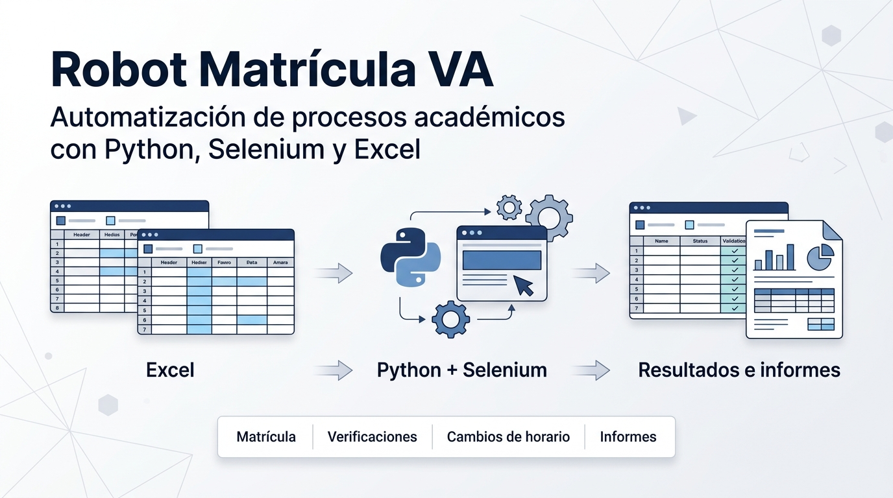
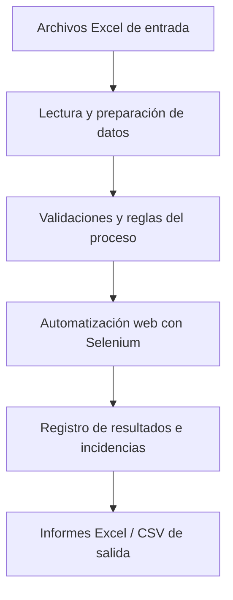
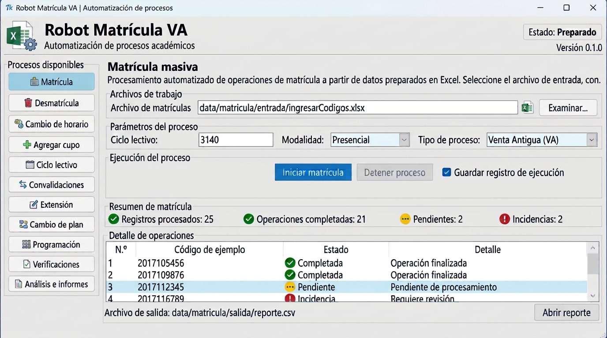
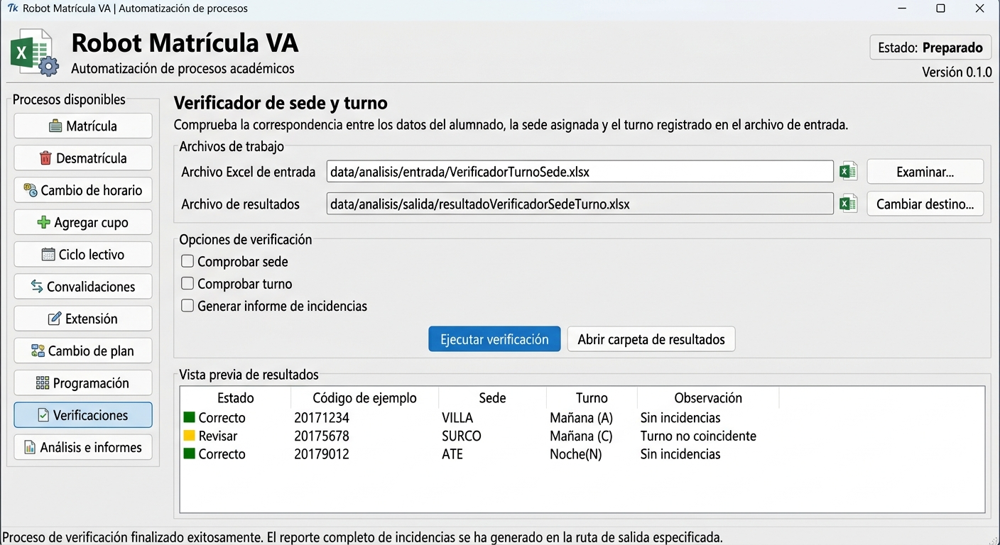

<p align="center">
  
</p>
<div align="center">
# 🤖 Robot Matrícula VA
 
**Automatización de procesos académicos con Python, Selenium y Excel**
 


 
</div>
---
 
## 📌 Descripción
 
**Robot Matrícula VA** es un conjunto de scripts en Python que automatiza tareas repetitivas de gestión académica sobre una plataforma web: matrícula masiva, verificación de datos, cambios de plan, gestión de cupos y ciclos lectivos.
 
Cada proceso lee sus datos de entrada desde archivos **Excel**, ejecuta las operaciones en el navegador con **Selenium** y deja como resultado informes en **Excel/CSV** para revisar lo ocurrido y detectar incidencias.
 
El proyecto nace de necesidades operativas reales: reducir la carga manual, evitar errores de digitación y dejar trazabilidad de cada ejecución.
 
## 🎯 Objetivos
 
- Automatizar operaciones repetitivas de matrícula y administración académica.
- Procesar información de forma estructurada a partir de archivos Excel.
- Validar datos y condiciones académicas antes de ejecutar operaciones.
- Registrar resultados e incidencias para su revisión posterior.
- Reducir la intervención manual y el margen de error.
## ✨ Funcionalidades
 
| Módulo | Descripción |
|---|---|
| **Matrícula masiva** | Ejecuta operaciones de matrícula a partir de datos preparados en Excel. |
| **Desmatrícula** | Automatiza la baja de matrícula en lote. |
| **Prematrícula** | Procesa y verifica la información asociada a la prematrícula. |
| **Verificación de mallas y notas** | Comprueba la información de cursos, planes de estudio y notas. |
| **Cambios de plan** | Gestiona modificaciones del plan de estudios. |
| **Cambios de horario** | Automatiza cambios de horario. |
| **Ciclos lectivos** | Asigna o elimina ciclos lectivos. |
| **Gestión de cupos** | Automatiza la asignación de cupos. |
| **Reportes** | Genera archivos de resultados con las operaciones realizadas e incidencias. |
 
> Los módulos son independientes entre sí: cada script resuelve un proceso concreto y puede ejecutarse por separado.
 
## 🧱 Tecnologías
 
| Tecnología | Uso |
|---|---|
| **Python** | Lógica de automatización y reglas del proceso |
| **Selenium** | Control del navegador e interacción con la plataforma web |
| **pandas** | Lectura, limpieza y validación de datos tabulares |
| **openpyxl** | Lectura y escritura de archivos Excel |
| **Excel / CSV** | Formatos de entrada y salida |
 
## 🔄 Flujo de trabajo
 

 
## 🗂️ Estructura del repositorio
 
```text
RobotMatriculaVA/
├── src/
│   ├── matricula/
│   │   ├── main_completo.py          # Ejecución de varios procesos
│   │   ├── Desmatricula.py
│   │   └── Cambio_Horario.py
│   ├── verificaciones/
│   │   ├── Verificador_Malla_Notas.py
│   │   └── Verificador_Pre_Matricula.py
│   ├── planes_y_ciclos/
│   │   ├── Cambio_Plan.py
│   │   ├── AgregarCicloLectivo.py
│   │   └── EliminarCicloLectivo.py
│   └── cupos/
│       └── Main_agregacupo.py
├── data/                             # Excel/CSV reales (ignorados por Git)
│   ├── input/
│   └── output/
├── docs/
│   └── images/
├── requirements.txt
├── .gitignore
└── README.md
```
 
> Ajusta este árbol a la distribución real de carpetas de tu repositorio.
 
## ⚙️ Requisitos y ejecución
 
> **Nota:** el proyecto se desarrolló para una plataforma académica de uso interno y requiere credenciales y acceso autorizado. Por ello no está pensado para ejecutarse tal cual fuera de ese entorno: este repositorio documenta la solución y el enfoque técnico utilizado.
 
**Requisitos**
 
- Python 3.9 o superior
- Dependencias: `selenium`, `pandas`, `openpyxl`
- Navegador y driver compatibles con Selenium
- Acceso autorizado a la plataforma
- Archivos Excel de entrada con las columnas que espera cada script
**Flujo general de ejecución**
 
1. Preparar el archivo Excel de entrada del proceso y colocarlo en `data/input/`.
2. Ejecutar el script correspondiente, por ejemplo:
```bash
python src/verificaciones/Verificador_Pre_Matricula.py
```
 
3. Revisar los informes generados en `data/output/`.
### Archivos de entrada y salida
 
| Tipo | Ejemplos |
|---|---|
| **Entrada** | `PreMatricula.xlsx`, `Cambio_plan.xlsx`, `CodigosVerificarMalla.xlsx`, `ingresarCodigos.xlsx` |
| **Salida** | `resultadoPreMatricula.xlsx`, `resultados_mallas.xlsx`, `reporte.csv`, `reporteCicloLectivo.csv` |
 
> No todos los archivos intervienen en una misma ejecución: cada script usa los que corresponden a su proceso.
 
## 🖼️ Vista previa
 
<p align="center">
  
  <br><em>Módulo de matrícula masiva</em>
</p>
<p align="center">
  
  <br><em>Módulo de verificaciones</em>
</p>
> Capturas de interfaz implementada.
 
## 🔐 Seguridad y buenas prácticas
 
- Usa el proyecto únicamente en entornos y con cuentas **autorizadas**.
- **Nunca** subas al repositorio credenciales, cookies de sesión, datos personales ni archivos académicos reales.
- Los datos reales viven en `data/` y están excluidos mediante `.gitignore`.
- Las credenciales deben leerse desde variables de entorno o un archivo local no versionado, nunca desde el código.
- Prueba primero con un conjunto pequeño de datos antes de lanzar procesos masivos.
## 🛣️ Roadmap
 
- [x] Reorganización del repositorio por módulos
- [x] Exclusión de datos sensibles con `.gitignore`
- [ ] Revisión del código para eliminar valores sensibles o fijos
- [ ] Gestión de configuración centralizada
- [ ] Registro de logs estructurado
- [ ] Interfaz gráfica (Tkinter u otra)
## 💡 Competencias demostradas
 
- Automatización web con Python y Selenium
- Procesamiento y validación de datos con pandas, Excel y CSV
- Implementación de reglas de negocio y control de incidencias
- Organización de código en scripts y módulos independientes
- Resolución de problemas operativos en un entorno de trabajo real
## 👤 Autor
 
**Jesús Ramos**
Desarrollo de software · Automatización con Python · Selenium · Procesamiento de datos
 
[](https://github.com/jesuslink1)